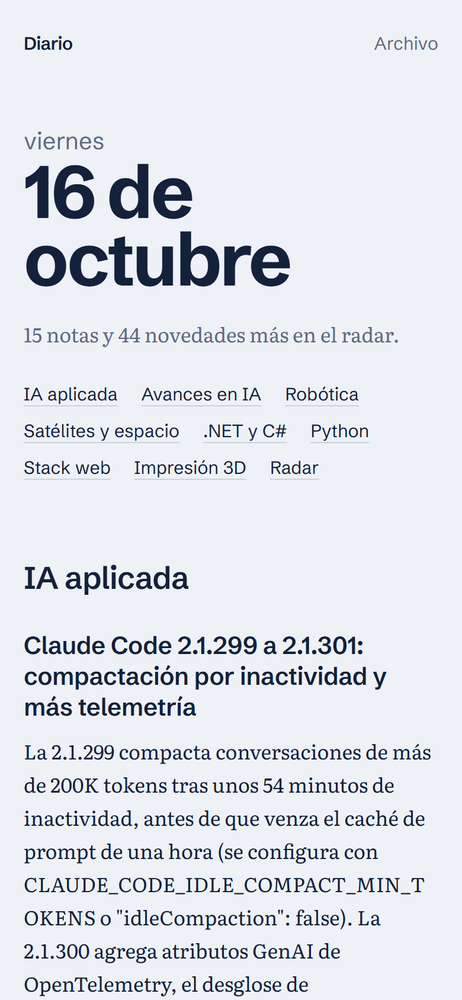
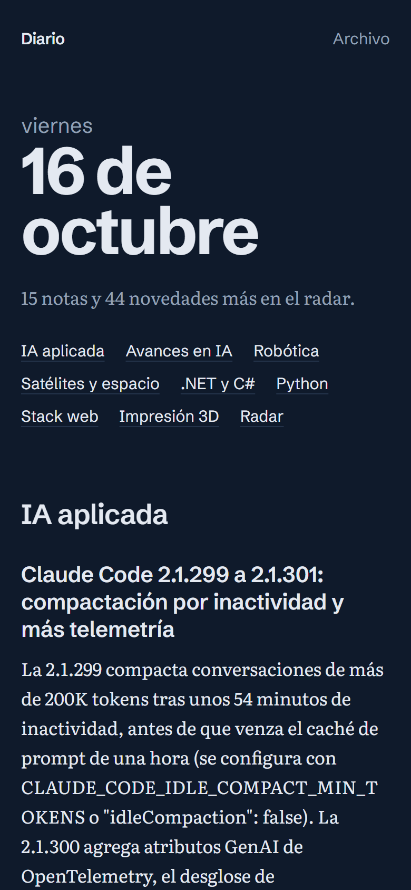
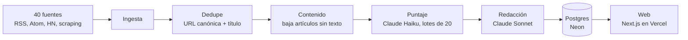

# devbrief

Un diario técnico personal que se escribe solo. Cada mañana a las 6 junta las
novedades de 40 fuentes (blogs, releases de GitHub, Hacker News, medios de IA
de EE.UU., China y Rusia, robótica y espacio), las puntúa con Claude según un
perfil de intereses y publica un diario de 10 a 15 notas en español, más un
**Radar** con una línea por cada otra novedad de IA, robótica o espacio.

Reemplaza scrollear Twitter y Reddit por cinco minutos de lectura.

<p align="center">
  
  &nbsp;&nbsp;
  
</p>

## Cómo funciona



1. **Ingesta.** Lee las fuentes activas de [`config/fuentes.yaml`](config/fuentes.yaml) en
   paralelo. Si una falla, se registra y se sigue con las demás.
2. **Normalización y dedupe.** Cada noticia se identifica por su URL canónica (sin tracking,
   fragmento ni `www`). Además se fusionan títulos casi iguales de fuentes distintas, sin
   confundir versiones (`3.16 alpha 1` ≠ `alpha 2`) ni releases parecidos. Que una noticia
   aparezca en varias fuentes queda guardado como señal de relevancia.
3. **Contenido.** La mayoría de los items de Hacker News traen solo título y link: se baja el
   artículo y se extrae el texto principal.
4. **Puntaje.** Claude Haiku evalúa cada noticia de 0 a 10 contra
   [`config/perfil.md`](config/perfil.md), en lotes de 20, con salida estructurada.
5. **Redacción.** Claude Sonnet escribe el diario: entran todas las de 7 o más (completando
   con las mejores de 6 hasta llegar a 10), fusiona las que cuentan lo mismo aunque vengan
   en otro idioma y arma el Radar.
6. **Web.** Next.js lee el diario de la base y lo muestra; se revalida cada minuto.

Todo corre en GitHub Actions a las 6:00 de Argentina.

## Decisiones de diseño

**Sin costo extra: el LLM corre sobre la suscripción de Claude.** Las llamadas van por
Claude Code en modo no interactivo (`claude -p` con `--json-schema`), que usa el cupo de la
suscripción en vez de créditos de API. El subproceso corre sin `ANTHROPIC_API_KEY` en el
entorno (para que nunca facture por API), en una carpeta vacía, sin herramientas ni
configuración del usuario. La API de Anthropic queda como backend alternativo detrás de la
misma interfaz (`LLM_BACKEND=api`). Como referencia, la primera corrida real (tres días
de noticias, unas 340) habría costado unos US$ 0,30 por API.

**Una sola fuente de verdad para el esquema.** [`web/prisma/schema.prisma`](web/prisma/schema.prisma)
define las tablas y genera las migraciones. El pipeline de Python no tiene ORM: escribe con
SQL explícito ([`repositorio.py`](pipeline/src/diario/repositorio.py)) sobre las mismas
tablas, así el modelo no está definido dos veces. Un control en los tests avisa si a la base
de prueba le falta alguna migración.

**Idempotente de punta a punta.** Correr el pipeline dos veces el mismo día no duplica nada ni
gasta tokens de más: los items se insertan con `ON CONFLICT`, solo se puntúa lo que no tiene
puntaje y hay un diario por fecha. Cada puntaje se guarda apenas llega, así que un corte a
mitad de camino no tira lo ya pagado.

**No confiar en el modelo para lo que importa.**
- Las URLs y las fuentes de cada nota salen de la base por id, nunca del texto del modelo.
- Todo lo que devuelve se valida (pydantic): una evaluación rota gasta un intento de ese item
  (máximo 2), no del lote entero.
- Si el modelo omite una novedad que va al Radar, el código la agrega igual.
- El contenido de la web entra al prompt delimitado y marcado como dato, nunca como
  instrucción.

**Errores con criterio.** Una fuente caída no corta nada. Un error transitorio de la API se
reintenta en la próxima corrida sin gastar intentos. Un error fatal (cupo agotado,
credenciales) corta la etapa y el workflow sale en rojo.

**Costo controlado.** El contenido se recorta antes de mandarlo al LLM, el system prompt se
cachea, hay un tope de items por corrida y cada corrida queda registrada en la tabla
`corridas` con sus tokens y errores.

## Estructura

```
config/              fuentes.yaml y perfil.md: qué leer y qué le importa al lector
pipeline/            Python 3.12, uv
  src/diario/
    fuentes/         fetchers: RSS/Atom, Hacker News (Algolia), scraping, artículos
    llm/             backends (claude -p y API), prompts y parseo de puntaje y redacción
    normalizacion.py URL canónica, HTML a texto, recortes
    dedupe.py        agrupado por URL y por similitud de título
    repositorio.py   todo el SQL
    pipeline.py      orquestación de las etapas
    cli.py           comandos
  tests/             unitarios con fixtures grabados + integración contra Postgres
web/                 Next.js 16 (App Router, Cache Components), Prisma 7, Tailwind 4
  prisma/            esquema y migraciones (fuente de verdad)
.github/workflows/   corrida diaria, CI y migraciones
```

## Correrlo localmente

Requisitos: [uv](https://docs.astral.sh/uv/), Node 24, una base en [Neon](https://neon.tech)
(plan gratuito) y [Claude Code](https://claude.com/claude-code) con sesión iniciada.

```bash
cp .env.example .env              # completar DATABASE_URL

cd web
npm install
npm run db:deploy                 # crea las tablas
cd ../pipeline
uv sync
uv run diario probar-fuentes      # ¿responden todas las fuentes?
uv run diario run                 # ingesta, puntaje y diario de hoy
cd ../web
npm run dev                       # http://localhost:3000
```

### Comandos del pipeline

| Comando | Qué hace |
|---|---|
| `diario run` | Corrida completa: ingesta, contenido, puntaje y redacción. `--forzar` regenera el diario de hoy. |
| `diario ingestar` | Trae las fuentes activas, deduplica y guarda lo nuevo. |
| `diario completar-contenido` | Baja el texto de los artículos que llegaron solo con título. |
| `diario puntuar` | Puntúa lo pendiente. `--repuntuar` vuelve a puntuar lo no publicado (después de cambiar el perfil). |
| `diario redactar` | Escribe el diario del día. `--fecha` y `--forzar` opcionales. |
| `diario fuentes` | Lista las fuentes (`--todas` incluye las inactivas). |
| `diario probar-fuentes` | Prueba cada fuente e informa cuáles fallan. |

### Configuración

| Variable | Para qué |
|---|---|
| `DATABASE_URL` | Connection string de Neon (la del pooler). |
| `LLM_BACKEND` | `claude-code` (default, usa la suscripción) o `api`. |
| `CLAUDE_CODE_OAUTH_TOKEN` | En CI: token de la suscripción, generado con `claude setup-token`. |
| `ANTHROPIC_API_KEY` | Solo con `LLM_BACKEND=api`. |
| `TEST_DATABASE_URL` | Opcional: branch de Neon aparte para los tests de integración. |

Para sumar una fuente alcanza con agregarla a `config/fuentes.yaml` y correr
`diario probar-fuentes`. Para cambiar qué se considera importante, se edita
`config/perfil.md` y se corre `diario puntuar --repuntuar`.

## Tests

```bash
cd pipeline
uv run pytest            # 218 tests
uv run ruff check . && uv run mypy src tests
```

Los fetchers se prueban contra fixtures grabados de los feeds reales (sin red), el LLM con
un cliente falso (sin tokens) y el repositorio contra un branch de Neon dedicado, con
salvaguardas para no tocar nunca la base principal. Sin `TEST_DATABASE_URL`, los tests de
integración se saltean.

## Deploy

- **Pipeline:** [GitHub Actions](.github/workflows/diario.yml) con cron a las 09:00 UTC y
  ejecución manual. Secrets: `DATABASE_URL` y `CLAUDE_CODE_OAUTH_TOKEN`.
- **Web:** Vercel (plan gratuito), con `web` como carpeta raíz y `DATABASE_URL` como variable.
- **Migraciones:** se aplican solas al llegar a `main` ([workflow](.github/workflows/migraciones.yml)).

## Próximos pasos

- Fetchers de Reddit y GitHub Trending (ya están en `fuentes.yaml`, apagados).
- Envío del diario por mail o Telegram a la mañana, y búsqueda en el archivo.
- 👍/👎 por nota que ajuste el perfil, resumen semanal y una sección diaria "Probalo hoy".
